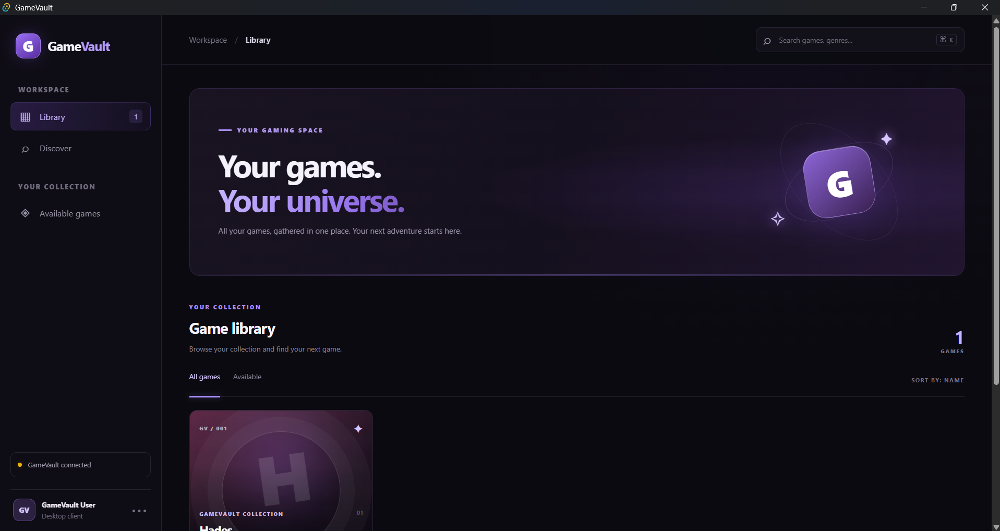
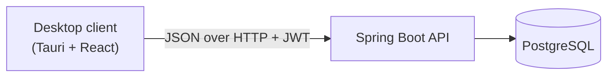

# GameVault

[](https://github.com/MaximTR123/GameVault/actions/workflows/ci.yml)


A game store platform: a **Spring Boot REST API** with JWT authentication, role-based access, a game catalog, purchases and a personal library, plus a **Tauri + React desktop client** (work in progress).

The long-term goal is to grow GameVault from a Steam-like store into a small platform where indie developers can publish their games.



> The screenshot shows the desktop client (Tauri + React), currently under active development.

## Features

- Registration and login with **JWT** access tokens
- Two roles: `USER` and `ADMIN`
- Game catalog: public read access, admin-only create / update / delete
- Purchases with a **price snapshot** (the library keeps the price you actually paid)
- Personal **library** of purchased games
- Admin tools: list users, create users, change roles, delete users
- Consistent error handling with meaningful HTTP status codes
- One-command setup with **Docker Compose** (API + PostgreSQL)
- Automated tests, coverage report and CI pipeline

## Architecture



The API is a layered application: `controller` → `service` → `repository`, with DTOs at the boundary, a JWT filter in the Spring Security chain and a global exception handler.

## Tech stack

| Area | Technology |
|---|---|
| Language / runtime | Java 21 |
| Backend | Spring Boot, Spring Web, Spring Data JPA (Hibernate), Spring Security, Bean Validation |
| Auth | JWT (jjwt), BCrypt password hashing |
| Database | PostgreSQL 17 (H2 in-memory for tests) |
| Desktop client | Tauri 2, React, TypeScript, Vite |
| Testing | JUnit 5, Mockito, Java `HttpClient` integration tests, JaCoCo |
| Code quality | Checkstyle, SpotBugs |
| DevOps | Docker, Docker Compose, GitHub Actions, Dependabot |

## Getting started

### Run with Docker (recommended)

Requirements: [Docker](https://www.docker.com/products/docker-desktop/) with Docker Compose.

```bash
git clone https://github.com/MaximTR123/GameVault.git
cd GameVault

cp .env.example .env        # Windows PowerShell: Copy-Item .env.example .env
# open .env and fill in the values (see "Configuration" below)

docker compose up --build
```

The API is now available at <http://localhost:8080>.

If you set `ADMIN_PASSWORD`, an initial admin user is created on the first start.

### Try the API

```bash
# the catalog is public (empty at first)
curl http://localhost:8080/api/games

# log in as the initial admin
curl -X POST http://localhost:8080/api/auth/login \
  -H "Content-Type: application/json" \
  -d '{"username": "admin", "password": "<your ADMIN_PASSWORD>"}'

# create a game (use the token from the login response)
curl -X POST http://localhost:8080/api/games \
  -H "Content-Type: application/json" \
  -H "Authorization: Bearer <token>" \
  -d '{"name": "Hades", "description": "Roguelike dungeon crawler", "price": 24.99, "genre": "ACTION", "available": true}'
```

Stop everything with `docker compose down` (add `-v` to also delete the database volume).

### Run the API locally (without Docker)

Requirements: JDK 21, Maven (or the included `mvnw` / `mvnw.cmd`) and a running PostgreSQL.

The easiest way to get a database is to start only the database container:

```bash
docker compose up -d db
```

It is exposed on `localhost:5433`. Then set the environment variables and start the API:

```bash
export DB_URL=jdbc:postgresql://localhost:5433/<DB_NAME>
export DB_USERNAME=<DB_USER>
export DB_PASSWORD=<DB_PASSWORD>
export JWT_SECRET=<at least 32 characters>

mvn spring-boot:run
```

(On Windows PowerShell use `$env:JWT_SECRET = "..."`, or set the variables in your IDE run configuration.)

### Run the desktop client

> Status: work in progress. Lives in the `desktop/` folder.

Requirements: Node.js (LTS), the Rust toolchain and the [Tauri prerequisites](https://v2.tauri.app/start/prerequisites/) for your OS (on Windows: Microsoft C++ Build Tools and WebView2).

```bash
cd desktop
npm install
npm run tauri dev
```

The client talks to the API at `http://localhost:8080` by default. Change it with `VITE_API_URL` in `desktop/.env.development`. The API must be running, and its CORS configuration already allows the client's origins.

## Configuration

All secrets are passed through environment variables. **Never commit your `.env` file.**

| Variable | Required | Description |
|---|---|---|
| `DB_NAME` | Docker | Database name |
| `DB_USER` | Docker | Database user |
| `DB_PASSWORD` | yes | Database password |
| `JWT_SECRET` | yes | Secret used to sign JWTs, at least 32 characters |
| `ADMIN_USERNAME` | no | Initial admin username (default `admin`) |
| `ADMIN_EMAIL` | no | Initial admin e-mail (default `admin@example.com`) |
| `ADMIN_PASSWORD` | no | Initial admin password, at least 8 characters. If empty, no admin is created |
| `DB_URL` | local run | JDBC URL (default `jdbc:postgresql://localhost:5432/gamevault`) |
| `DB_USERNAME` | local run | Database user for a local run (default `postgres`) |
| `CORS_ALLOWED_ORIGINS` | no | Comma-separated list of allowed origins; the defaults cover the desktop client |

Generate a strong `JWT_SECRET`:

```bash
openssl rand -base64 48
```

```powershell
$bytes = New-Object byte[] 48
[System.Security.Cryptography.RandomNumberGenerator]::Create().GetBytes($bytes)
[Convert]::ToBase64String($bytes)
```

## API overview

Authenticated endpoints expect the header `Authorization: Bearer <token>`.

| Method | Path | Access | Description |
|---|---|---|---|
| `POST` | `/api/auth/register` | public | Register a new user (role `USER`) |
| `POST` | `/api/auth/login` | public | Log in, returns user data and a JWT |
| `GET` | `/api/games` | public | List games |
| `GET` | `/api/games/{id}` | public | Get one game |
| `POST` | `/api/games` | admin | Create a game |
| `PUT` | `/api/games/{id}` | admin | Update a game |
| `DELETE` | `/api/games/{id}` | admin | Delete a game (not allowed if it has purchases) |
| `POST` | `/api/purchases` | user | Purchase a game (`{"gameId": 1}`) |
| `GET` | `/api/library` | user | List the games you own |
| `GET` | `/api/users` | admin | List users |
| `GET` | `/api/users/{id}` | admin | Get one user |
| `POST` | `/api/users` | admin | Create a user with a chosen role |
| `PUT` | `/api/users/{id}/role` | admin | Change a user's role |
| `DELETE` | `/api/users/{id}` | admin | Delete a user |

Game genres: `ACTION`, `RPG`, `HORROR`, `STRATEGY`, `INDIE`, `SIMULATION`.

### Error responses

| Status | Meaning |
|---|---|
| `400` | Validation failed, or a business rule was violated |
| `401` | Wrong username or password |
| `403` | Missing or invalid token, or not enough permissions |
| `404` | User or game not found |
| `409` | Conflict: duplicate username / e-mail, game already purchased, game has purchases |

## Business rules

- A user can buy each game only once (enforced in the service and by a unique database constraint)
- Unavailable games cannot be purchased
- The library keeps the price paid at the time of purchase, even if the game's price changes later
- A game that has purchases cannot be deleted
- An admin cannot delete their own account
- The last remaining admin cannot be demoted
- Passwords are stored only as BCrypt hashes and are never returned by the API

## Testing and code quality

```bash
mvn clean verify
```

This compiles the project, runs all tests and generates the reports.

- **Integration tests** start the whole application on a random port with an in-memory H2 database and call the real HTTP API (authentication, roles, validation, purchases, library, error handling)
- **Unit tests** use Mockito for isolated service logic
- **Coverage:** the JaCoCo report is in `target/site/jacoco/index.html`
- **Static analysis:** Checkstyle (`checkstyle.xml`) and SpotBugs (`spotbugs-exclude.xml`) run as part of the build

## CI

[GitHub Actions](.github/workflows/ci.yml) runs on every pull request and on pushes to `main`:

1. Builds the project with Java 21 and runs the tests
2. Publishes a coverage summary on the run page and uploads the reports as artifacts
3. Builds the Docker image

[Dependabot](.github/dependabot.yml) keeps Maven dependencies, GitHub Actions and Docker base images up to date.

## Project structure

```
.
├── src/main/java/com/gamevault/server/
│   ├── config/        # security, CORS, password encoder, initial admin
│   ├── controller/    # REST controllers
│   ├── dto/           # request / response objects
│   ├── exception/     # custom exceptions and the global handler
│   ├── model/         # JPA entities and enums
│   ├── repository/    # Spring Data repositories
│   ├── security/      # JWT service and authentication filter
│   └── service/       # business logic
├── src/test/java/     # integration and unit tests
├── desktop/           # Tauri + React desktop client (work in progress)
├── .github/           # CI workflow and Dependabot configuration
├── Dockerfile
├── compose.yaml
└── pom.xml
```

## Roadmap

- [x] REST API: authentication, roles, catalog, purchases, library
- [x] Automated tests, coverage report, CI
- [x] Docker and Docker Compose setup
- [ ] Desktop client: login and registration, catalog, purchases, library
- [ ] Admin panel in the desktop client
- [ ] Database migrations (Flyway)
- [ ] Refresh tokens
- [ ] Tests against a real PostgreSQL (Testcontainers)
- [ ] Platform for indie developers: publishing games and build uploads
- [ ] Installer builds of the desktop client in CI

## License

This project is licensed under the MIT License. See the `LICENSE` file for details.
